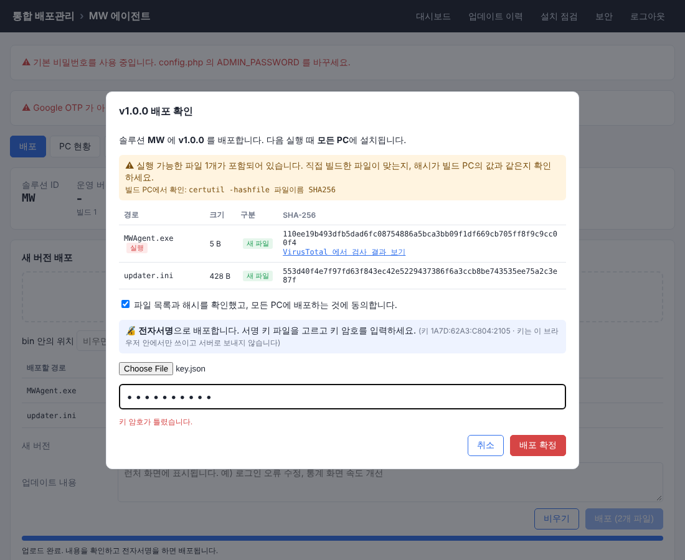

# 통합 프로그램 런처 및 자동 배포관리 시스템 (MVP)

기획서 v1.0 의 **14장 MVP 필수 기능**을 구현한 버전입니다.
개발자는 관리 웹에 새 버전을 올리기만 하면 되고, 각 PC의 런처(Updater.exe)는 실행할 때마다 바뀐 파일만 받아 최신 버전을 유지한 뒤 프로그램을 실행합니다.

| 화면 | |
|---|---|
| 런처 | `docs/launcher.png` |
| 대시보드 | `docs/dashboard.png` |
| 새 버전 배포 | `docs/deploy.png` |
| PC 현황 | `docs/pc-status.png` |

## 구성
```
auto-updater/
├─ updater/                 ← 클라이언트 런처 (각 PC의 bin 폴더)
│   ├─ Updater.exe          미리 빌드된 런처 (v2.0.0)
│   ├─ Updater.cs           소스 (C# 5, .NET Framework 4.5+)
│   ├─ build.bat            Windows 내장 컴파일러로 빌드 (설치 불필요)
│   └─ updater.ini          서버 주소 + 솔루션 ID
└─ server/                  ← 통합 배포관리 웹 + 업데이트 API (PHP 7.0+)
    ├─ index.php            관리 웹 (대시보드 / 솔루션별 배포·PC 현황·이력·설정)
    ├─ api.php              관리 웹 내부 API
    ├─ api/v1/launcher/     런처 API: check.php(업데이트 확인+PC 등록), report.php(결과 보고)
    ├─ config.php           관리자 비밀번호, DB, 런처 인증키
    ├─ manifests/           솔루션별 공개 Manifest (MWAGENT.json …, 자동 생성)
    ├─ files/               배포 파일 저장소 (SHA-256 이름, 모든 솔루션 공용)
    ├─ data/                솔루션·버전 이력(JSON), PC 현황 DB(updater.db) — 외부 접근 차단
    └─ tools/Updater.exe    관리 웹에서 내려받기용 런처
```

## 기술 스택
- **관리 웹 / API**: PHP 7.0 이상. 일반 웹호스팅에서 동작.
- **DB**: 기본 SQLite (`data/updater.db`, 설치 불필요, PHP `pdo_sqlite` 필요). `config.php` 에서 MySQL/MariaDB 로 바꿀 수 있고 테이블은 자동 생성됩니다.
  - 솔루션·버전·배포 이력은 `data/apps/<ID>/` 의 JSON 파일, PC 현황·업데이트 이력은 DB 에 저장합니다.
- **런처**: C# WinForms, .NET Framework 4.5+ (Windows 10/11 기본 포함).

## 1. 서버 설치 (한 번만)
> **시놀로지 NAS(Web Station)에 설치한다면 [SYNOLOGY.md](SYNOLOGY.md) 의 단계별 가이드를 따라 하세요.**

1. `server` 폴더 내용을 웹서버에 올립니다. 예: `https://내도메인/updates/`
2. `config.php` 에서 `ADMIN_PASSWORD` 를 바꿉니다. (필요하면 `DB_DSN`, `CLIENT_KEY` 도)
3. `files/`, `manifests/`, `data/` 폴더에 웹서버(PHP) 쓰기 권한을 줍니다.
4. 브라우저로 접속해 로그인한 뒤, 상단 **설치 점검** 메뉴에서 모든 항목이 정상인지 확인합니다.
5. 상단 **보안** 메뉴에서 Google OTP 를 등록합니다. (아래 "Google OTP 로그인")

> 업로드 한도는 동봉한 `.htaccess` / `.user.ini` 로 512MB 까지 올려두었습니다. 호스팅에서 막혀 있으면 `upload_max_filesize`, `post_max_size` 를 늘려주세요.
> nginx 는 `.htaccess` 를 읽지 않으므로 `data/`, `views/` 접근 차단, `files/`·`manifests/` 에서 PHP 실행 금지, `client_max_body_size` 를 nginx 설정에 넣어주세요.
> 운영 시에는 HTTPS 사용을 권장합니다.

## Google OTP 로그인
관리 사이트는 비밀번호와 Google OTP(Google Authenticator 등 TOTP 앱) 6자리로 로그인합니다. 외부 라이브러리 없이 PHP 로 구현했습니다 (RFC 6238, SHA1, 6자리, 30초).
- **로그인 방식**: `config.php` 의 `OTP_MODE` — `password+otp`(기본, 권장) / `otp`(OTP 만) / `off`(비밀번호만).
- **등록**: 비밀번호로 로그인 → 상단 **보안** → 앱으로 QR 스캔(안 되면 설정 키 직접 입력) → 6자리 입력 → [등록]. 등록 전에는 비밀번호만으로 로그인되고 화면에 경고가 뜹니다.
- **보호**: 한 번 쓴 코드는 재사용 불가, 같은 IP 에서 5번 틀리면 10분 잠금, 세션 쿠키 HttpOnly.
- **휴대폰 분실/교체**: File Station 에서 `data/otp.json` 을 지우면 비밀번호로 로그인해 다시 등록할 수 있습니다. 교체할 때는 보안 메뉴에서 해제 후 재등록.
- 서버(NAS) 시계가 틀리면 코드가 맞지 않습니다. NTP 동기화를 켜두세요. 등록 화면의 QR 은 cdnjs 의 qrcodejs 로 브라우저에서 그리며, 비밀키는 외부로 전송되지 않습니다.

## 무단 배포 방지 (전자서명 + OTP 재확인)
악성 파일이 모든 PC 로 퍼지는 것을 막기 위해 세 겹으로 확인합니다.

| 작업 | 서명 키 등록 후 | 서명 키 등록 전 |
|---|---|---|
| 배포, 파일 삭제 배포, 롤백, PC 삭제 취소, 실행 파일 변경, 파일 복사 등록 | **전자서명** (키 파일 + 키 암호) | OTP 재확인 |
| 솔루션 삭제, 서명 키 등록/교체/해제 | OTP 재확인 | OTP 재확인 |

(OTP 미등록이거나 `OTP_MODE=off` 이면 OTP 대신 관리자 비밀번호를 다시 확인)

### 배포 전자서명 (인증서 구매 불필요)
- **보안 › 배포 전자서명 › 서명 키 만들기**: 브라우저에서 RSA 2048 키를 만들고, 비밀 키는 **키 암호로 잠근 파일**(sign-key-xxxx.json)로 내려받습니다. 서버에는 공개 키만 저장(`data/signkey.json`). 키 파일은 USB·다른 PC 등 두 곳 이상에 백업하고 NAS 에는 두지 마세요.
- **배포할 때**: 확인 창에서 키 파일을 고르고 키 암호를 넣으면 브라우저 안에서 서명해 보냅니다. 서버는 서명이 맞을 때만 반영하고, Manifest 에 `signed`(PC 가 따를 내용) + `signature` 를 넣습니다.
- **PC (Updater.exe 2.1.0+)**: updater.ini 에 `SignKey=` 가 있으면 서명을 확인하고 **서명된 내용만** 따릅니다. 서명이 없거나 틀리면, 다른 솔루션의 서명이면, 설치된 것보다 낮은 빌드면(옛 버전 되돌리기 공격) 설치하지 않고 기존 버전으로 실행합니다.
- 그래서 NAS 가 해킹되거나 관리자 비밀번호·OTP 가 유출돼도 **키 파일 + 키 암호 없이는 PC 에 아무것도 설치되지 않습니다.** 공지·활성 여부 같은 표시용 설정은 서명 없이 바꿀 수 있습니다.
- **기존 PC 에 적용 (런처 일괄 교체)**: 보안 › **기존 PC 런처 교체** › [새 런처 배포]. 서버의 `tools/Updater.exe` 와 공개 키 파일 `updater.signkey` 를 모든 솔루션에 새 버전으로 배포합니다. 이미 설치된 구버전 런처(2.0.x)도 다음 실행 때 이 파일들을 받아 **자기 자신을 새 런처로 교체**하고, 그다음 실행부터 서명을 확인합니다. 각 PC 의 updater.ini 는 덮어쓰지 않습니다. 교체 여부는 PC 현황의 런처 버전(2.1.0)으로 확인.
- 새로 설치하는 PC 는 [설정 / 설치]의 updater.ini 에 SignKey 가 들어 있습니다. 런처는 updater.ini 의 SignKey 와 updater.signkey 를 모두 읽습니다. 서명 없이 운영 중이던 솔루션은 배포 탭 **[지금 서명]** 으로 현재 버전에 서명을 붙일 수 있습니다.
- **키 교체**: [새 키로 교체] → 나오는 `SignKey=옛키,새키` 한 줄을 넣은 `updater.signkey` 파일을 지금 키로 배포 → PC 들이 받은 뒤 [다른 키 파일로 교체]로 새 키 등록. (SignKey 는 쉼표로 여러 개 가능)
- **주의**
  - 브라우저 보안 정책상 서명은 **https 접속**에서만 됩니다 (시놀로지: 제어판 › 보안 › 인증서에서 Let's Encrypt). PHP `openssl` 확장이 켜져 있어야 합니다.
  - 키 파일과 키 암호를 모두 잃어버리면 각 PC 의 updater.ini SignKey 를 직접 바꿔야 합니다.
  - 롤백은 그 버전의 updater.ini 도 되돌립니다. 키 교체 전 버전으로 롤백하면 PC 의 SignKey 가 옛 값으로 돌아가니 주의하세요.

### 배포 확인 창 · 감사 로그
- 확인 창에 올린 파일의 경로·크기·새 파일/교체·**SHA-256 전체**를 보여주고, `.exe/.dll/.bat/.ps1` 같은 실행 파일은 경고와 VirusTotal 조회 링크를 붙입니다. "확인했습니다" 체크가 있어야 진행됩니다. 빌드 PC 에서 `certutil -hashfile 파일 SHA256` 값과 비교하세요.
- OTP 재확인: 로그인에 쓴 코드는 재사용 불가(최대 30초 뒤 새 코드), 5번 틀리면 강제 로그아웃, 같은 IP 는 로그인 실패와 합산해 10분 잠금.
- **감사 로그** `data/audit.log`: 로그인/실패, 재인증 실패, 배포(파일별 해시, 서명 여부), 롤백, 삭제, 실행 설정 변경, 서명 키·OTP 변경, 서명 불일치를 IP·브라우저와 함께 기록하고 **보안** 메뉴에서 최근 100건을 봅니다.



## 2. 솔루션 등록 → 배포
1. **대시보드 › 새 솔루션 등록**: ID(예: `MWAGENT`), 솔루션명, 코드. 기존 솔루션의 파일을 복사해서 시작할 수도 있습니다.
2. **배포 탭**: 파일/폴더를 끌어다 놓고 → 새 버전(Major.Minor.Patch, 자동 제안) → 업데이트 내용 입력 → **배포**.
   - 바꿀 파일만 올리면 그 파일만 업데이트되고 나머지는 유지됩니다. 목록의 **[교체]** 로 특정 파일 하나만 바꿀 수도 있어요.
   - 올린 파일은 대기 목록에 모였다가 [배포] 시점에 한 버전으로 확정되므로 PC가 반쯤 올라간 상태를 받는 일이 없습니다.
   - 버전 번호는 지금까지 쓴 가장 높은 버전보다 커야 합니다 (롤백 후에도 번호가 겹치지 않음).
3. **설정 / 설치 탭**: 사용 여부(비활성 시 업데이트 중지), 서버 연결 실패 시 기존 버전 실행 허용 여부, 메인 실행 파일, 런처 공지사항. 여기서 **Updater.exe** 와 **솔루션용 updater.ini** 를 받습니다.
4. 각 PC의 bin 폴더에 두 파일을 넣고, 바로가기를 **Updater.exe** 로 만듭니다. (회사 로고를 쓰려면 bin 에 `logo.png`)

## 3. 운영
- **대시보드**: 솔루션 수, 설치 PC 수, 최신 버전 설치율, 7일간 성공/실패, 장기 미접속, 최근 배포, 최근 오류.
- **PC 현황 탭**: 전체 / 최신 / 구버전 / 실패 / 장기 미접속 / 차단 필터. PC별 설치 버전, 마지막 확인·업데이트 시각, 런처 버전, 설치 경로, 메모, **업데이트 허용/차단**.
- **업데이트 이력 탭**: PC별 업데이트 성공·실패·복구 기록 (버전 변화, 파일 수, 용량, 소요 시간, 오류 내용). 상단 메뉴에서 전체 솔루션 이력도 볼 수 있습니다.
- **버전 / 배포 이력**: 버전마다 업데이트 내용과 추가·교체·삭제 파일이 남고, 최근 50개 버전 중 하나로 **롤백**할 수 있습니다.

## 런처 동작 (기획서 3장, 5장)
1. 같은 bin 폴더에서 런처 중복 실행 방지
2. 지난 업데이트가 적용 도중 끊겼으면(PC 종료 등) 백업으로 **자동 복구** 후 서버에 '복구' 보고
3. `check` API 로 업데이트 확인 (처음이면 PC 자동 등록, PC ID 는 `C:\ProgramData\AutoUpdater\pcid.txt` 에 저장되어 여러 솔루션이 공유)
4. Manifest 기준으로 로컬 파일 비교 (경로·크기·SHA-256) → 없거나 다른 파일만 대상
5. **임시 폴더(`.update\staging`)에 다운로드 + SHA-256 검증** (파일당 3회 재시도). 이 단계에서 실패하면 설치 폴더는 전혀 바뀌지 않음
6. bin 폴더의 프로그램이 실행 중이면 교체하지 않고 종료 후 [다시 시도] 안내
7. 기존 파일을 `.update\backup` 으로 백업 → 새 파일 적용 → 실패 시 즉시 복구
8. 결과를 `report` API 로 보고 (서버에 못 보내면 다음 실행 때 재전송) → 프로그램 실행
- 서버 연결 실패 시: 솔루션 정책에 따라 기존 버전 실행 또는 차단
- 관리자가 PC를 차단했거나 솔루션이 비활성이면 업데이트 없이 현재 버전 실행
- `Updater.exe --repair` : 캐시를 무시하고 모든 파일을 다시 검사 (전체 동기화)
- 런처 자신(Updater.exe)도 배포 파일에 넣으면 자동 교체됩니다.
- 로그: `bin\.update\updater.log`

## 테스트 결과 (기획서 13장)
리눅스 테스트 환경(Mono)에서 실제 서버와 런처로 확인했습니다. 실제 Windows PC 테스트는 아직입니다.

| # | 시나리오 | 결과 |
|---|---|---|
| 1 | 최신 버전 실행 | 업데이트 없이 실행 ✔ |
| 2 | 신규 버전 배포 후 실행 | 자동 업데이트 후 실행 ✔ |
| 3 | 일부 파일 변경 | 변경 파일 1개만 다운로드 ✔ |
| 4 | 파일 해시 불일치 | 3회 재시도 후 업데이트 중단, 기존 파일 유지, 실패 보고 ✔ |
| 5 | 다운로드 실패 | 업데이트 중단, 기존 파일 유지 ✔ |
| 6 | 적용 중 종료 | 다음 실행 때 백업으로 복구, '복구' 보고 ✔ / 적용 중 오류 시 즉시 복구 ✔ |
| 7 | 서버 접속 불가 | 허용 정책이면 기존 버전 실행, 금지 정책이면 실행 차단 ✔ |
| 8 | 특정 솔루션만 배포 | 해당 솔루션 PC만 업데이트 ✔ |
| 9 | PC별 업데이트 제외 | 차단된 PC는 기존 버전 유지, 해제 후 업데이트 ✔ |
| 10 | 이전 버전으로 롤백 | 지정 버전 파일로 복구, 추가된 파일 삭제 ✔ |
| 11 | 런처 버전 변경 | Updater.exe 자체 교체 ✔ |
| 12 | 여러 PC 동시 업데이트 | 5대 동시 3MB 다운로드 정상 ✔ |

## 2차 구축 예정 (기획서 14장)
DEV / STAGING / PRODUCTION 채널, 단계별 배포(%), 배포 예약, 강제 업데이트, 관리자 계정/권한 분리(현재는 관리자 1명 + OTP 1개), 배포 통계.
